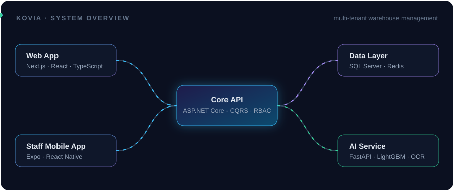

 

 

  

 

## ⚡ What I do

<table>
<tr>
<td width="33%" valign="top">

### 🏗️ Backend
APIs in **C# / ASP.NET Core** with Clean Architecture, CQRS, role-based permissions, background jobs and **SQL Server**.

</td>
<td width="33%" valign="top">

### 🎨 Frontend
Fast, typed UIs with **Next.js, React and TypeScript**, plus cross-platform staff apps with **Expo**.

</td>
<td width="33%" valign="top">

### 🤖 AI services
Practical ML with **Python / FastAPI**: demand forecasting, anomaly detection, document OCR and assistants.

</td>
</tr>
</table>

## 🧰 Tech stack

 

 

## 🚀 Featured project · Kovia

  

**Kovia** is a multi-tenant warehouse management platform built as a team project: inbound receiving, outbound, transfers, returns, stock counts and inventory tracking, with role- and warehouse-based permissions.
I worked **full-stack** across the API, the web app and the AI service.

🔗 Public repos: [Kovia Frontend Web](https://github.com/sswms-project/Kovia-Frontend-Web) · [Kovia Frontend Mobile](https://github.com/sswms-project/Kovia-Frontend-Mobile)
The backend and AI service repositories are private. Happy to walk through the architecture on request.

## 📈 Activity

  

<picture>
  <source media="(prefers-color-scheme: dark)" srcset="https://raw.githubusercontent.com/NgocThien2805/NgocThien2805/output/github-snake-dark.svg" />
  <source media="(prefers-color-scheme: light)" srcset="https://raw.githubusercontent.com/NgocThien2805/NgocThien2805/output/github-snake.svg" />
  
</picture>

## 🎯 Right now

- 🔭 Building production-style full-stack projects and AI-powered features
- 🌱 Going deeper into Java and Spring Boot
- 💬 Ask me about ASP.NET Core, Next.js, clean architecture or AI services

 

